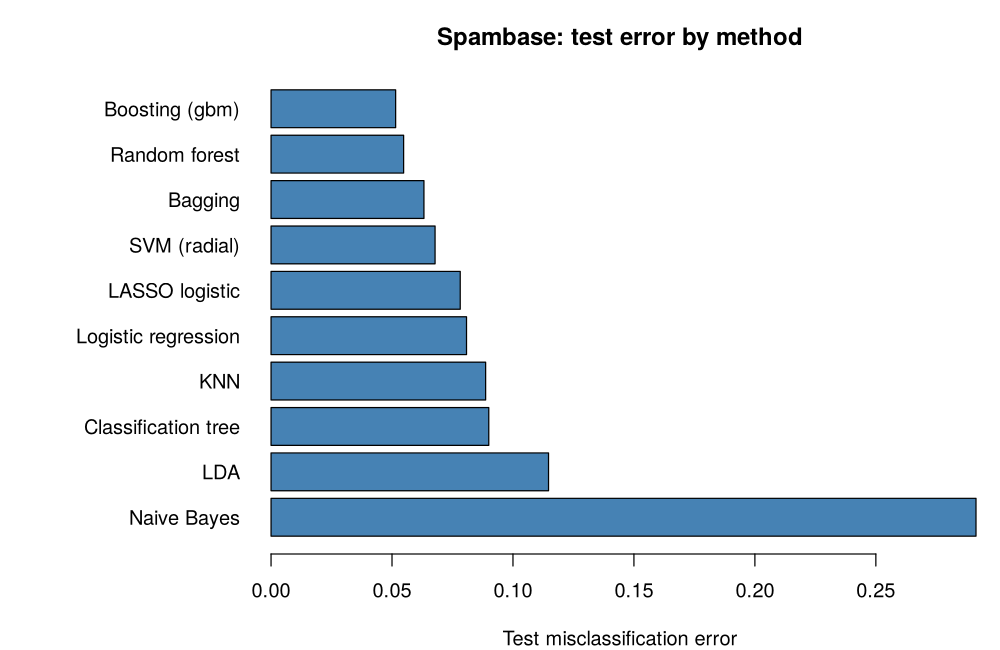
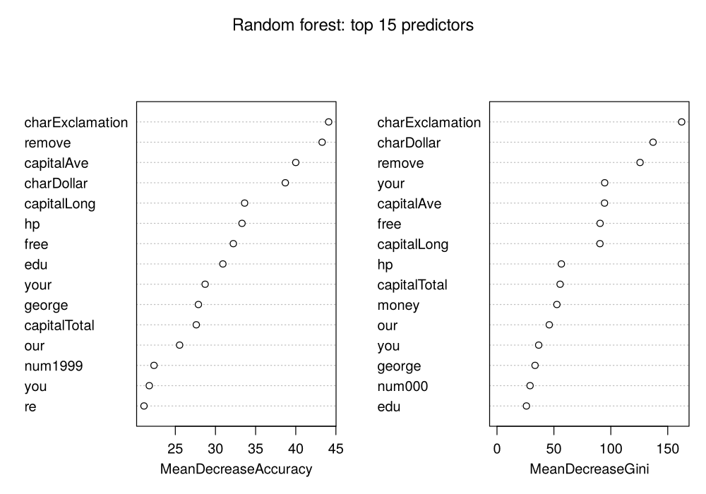

# Statistical learning in R: spam detection

A reproducible comparison of ten supervised learning methods on the UCI **Spambase** data (4,601 e-mails, 57 word- and character-frequency features). It grew out of my work for the *Supervised Statistical Learning* course in the MSc in Statistical Sciences at the University of Bologna.

## Setup

- **Split:** 2/3 training and 1/3 test (seed 1234). The test set is used only once, for the final comparison.
- **Standardisation:** done with training-set means and standard deviations, so no test information leaks in.
- **Tuning:** every hyper-parameter is tuned by 5-fold cross-validation on the training set, using the same folds for all hand-written CV loops. This covers k for KNN, λ for the LASSO, tree size, number of boosting iterations, and C and γ for the SVM.
- **Random forest and bagging:** these report out-of-bag error instead of CV error.

## Results

| Method | Tuning | CV error | Test error |
|---|---|---|---|
| Boosting (gbm) | 612 trees, depth 4, shrinkage 0.05 | 0.051 | **0.052** |
| Random forest | mtry = 7, 500 trees | 0.047 (OOB) | 0.055 |
| Bagging | mtry = 57, 500 trees | 0.055 (OOB) | 0.063 |
| SVM, radial kernel | C = 100, γ = 0.005 | 0.062 | 0.068 |
| LASSO logistic | λ (1-SE rule), 51 of 57 variables | 0.074 | 0.078 |
| Logistic regression | – | 0.070 | 0.081 |
| KNN | k = 5 | 0.095 | 0.089 |
| Classification tree | 16 leaves (1-SE pruning) | 0.093 | 0.090 |
| LDA | – | 0.105 | 0.115 |
| Naive Bayes (Gaussian) | – | 0.302 | 0.291 |



## Takeaways

- **Tree ensembles win.** Boosting and random forests reach about 5% test error, roughly half the error of a single pruned tree. Random forests beat bagging because random feature subsets decorrelate the trees.
- **Interpretable models are not far behind.** The LASSO keeps 51 of the 57 features and reaches about 8% error, close to the SVM.
- **Naive Bayes fails here.** The word frequencies are highly skewed and correlated, which breaks its Gaussian conditional-independence assumption.
- **The strongest predictors** are frequencies of `!` and `$`, the words *remove*, *free* and *your*, and runs of capital letters.



## Files

| File | Contents |
|---|---|
| `spam_classification.R` | The full analysis; writes `results/` and `figures/` |
| `results/model_comparison.csv` | CV and test error for every method |
| `figures/` | Model comparison, KNN and LASSO CV curves, pruned tree, variable importance |
| `cheatsheet.R` | My reference notes for supervised learning in R: data formats, when to standardise, CV templates, model syntax |

## Run it

```bash
Rscript spam_classification.R
```

The script installs any missing packages (`kernlab`, `class`, `MASS`, `e1071`, `glmnet`, `rpart`, `randomForest`, `gbm`). The data ships with `kernlab` as `data(spam)`. A full run takes about two minutes.

*Data: Hopkins, Reeber, Forman & Suermondt (1999), Spambase, UCI Machine Learning Repository.*
